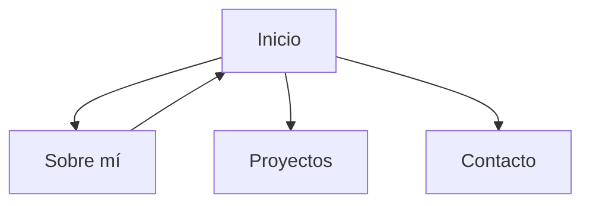

# PEC 4

## Descripción

En esta PEC estoy empezando a maquetar  a partir del diseño realizado en Figma .

Por ahora trabajé la estructura HTML y la distribución de las cajas con CSS.

## Herramientas utilizadas

- HTML
- CSS

## Páginas realizadas

**Inicio:** incluye la portada, el perfil, los proyectos, las habilidades y el contacto.

**Sobre mí:** incluye mi presentación, formación y conocimientos.

## Estructura de carpetas

- `index.html` y `sobre-mi.html`: páginas de la web.
- `css/main.css`: estilos de las páginas.
- `assets/img`: imágenes utilizadas.
- `assets/icons`: carpeta preparada para los iconos.

## Maquetación

Usé contenedores, Flexbox y Grid para organizar las secciones y distribuir las cajas.

También  añadi algunos colores y estilos básicos segun la referencia de figma

## Componentes

Trabajé con una cabecera, un menú de navegación, tarjetas para los proyectos y un pie de página.

## Cambios pendientes

En esta primera  parte empecé con la estructura y la distribución del contenido. Todavia faltan algunos detalles visuales.

Los enlaces de las tarjetas de proyectos son provisionales. Por ahora están preparados en el HTML, pero las páginas a las que dirigirán se desarrollarán más adelante.

También tengo pendiente incorporar las figuras geométricas de la sección Habilidades de la página de Inicio. Mi idea es realizarlas más adelante utilizando ayuda de IA

## Navegación

Proyectos y Contacto son secciones dentro de Inicio.

## Próximos pasos

Continuar con las páginas de detalle, completar los elementos visuales pendientes y seguir ajustando la maquetación respecto wireframes de figma.

## Enlace figma
Enlace figma PEC 3 : https://www.figma.com/design/EDeeBSlTwagK5VLdYWXPRx/PEC3_Revision?node-id=0-1&t=m9e8xVF44PUKxAdK-1

